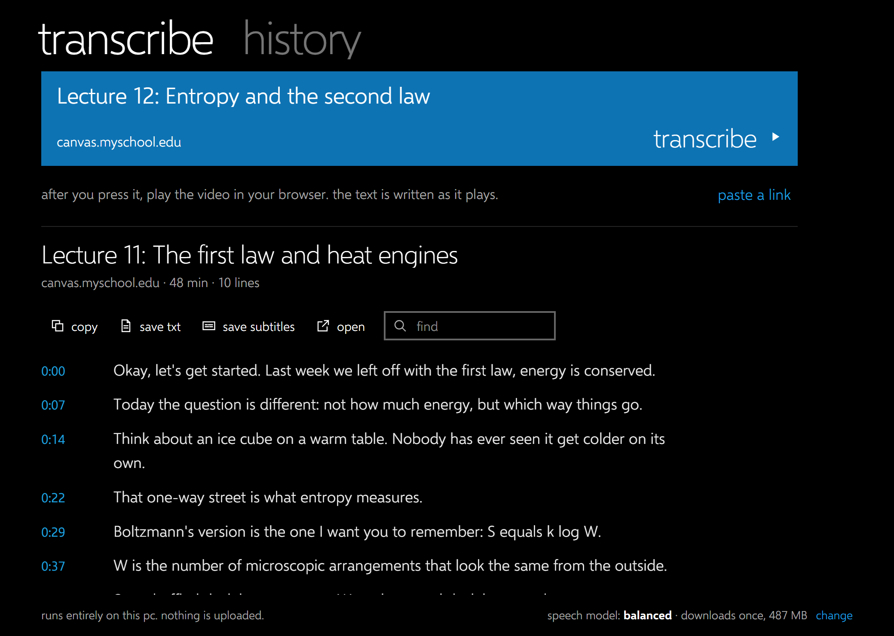
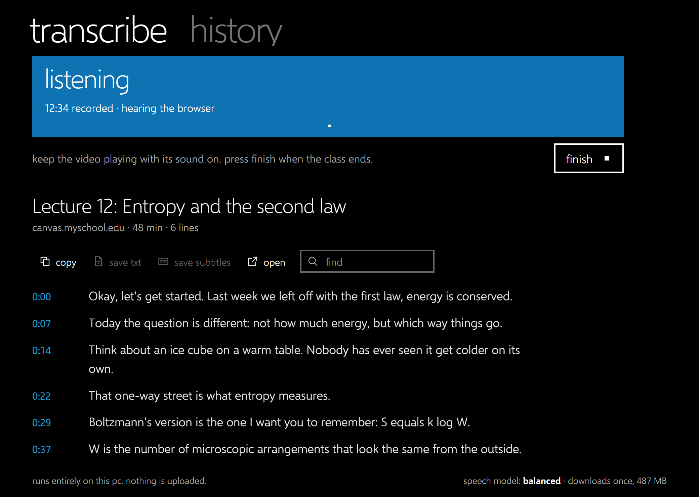
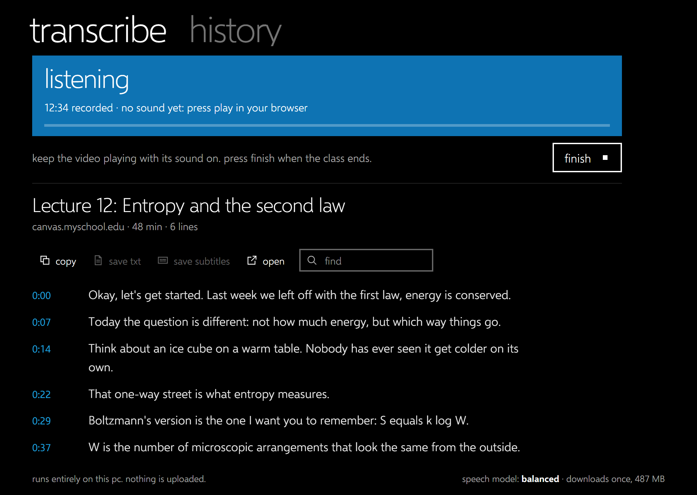
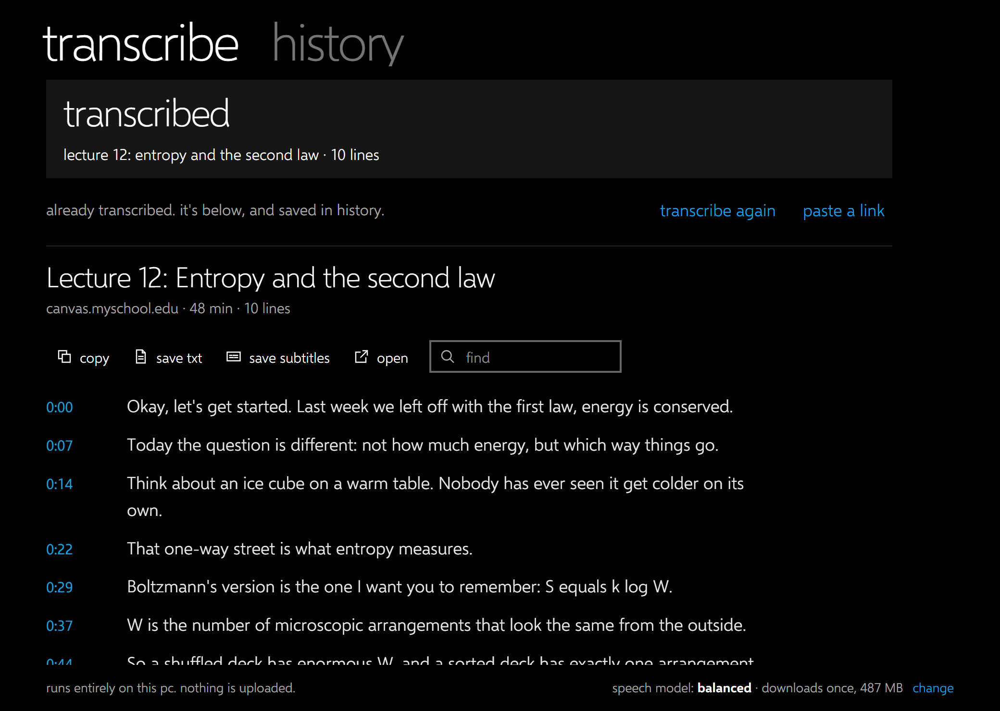
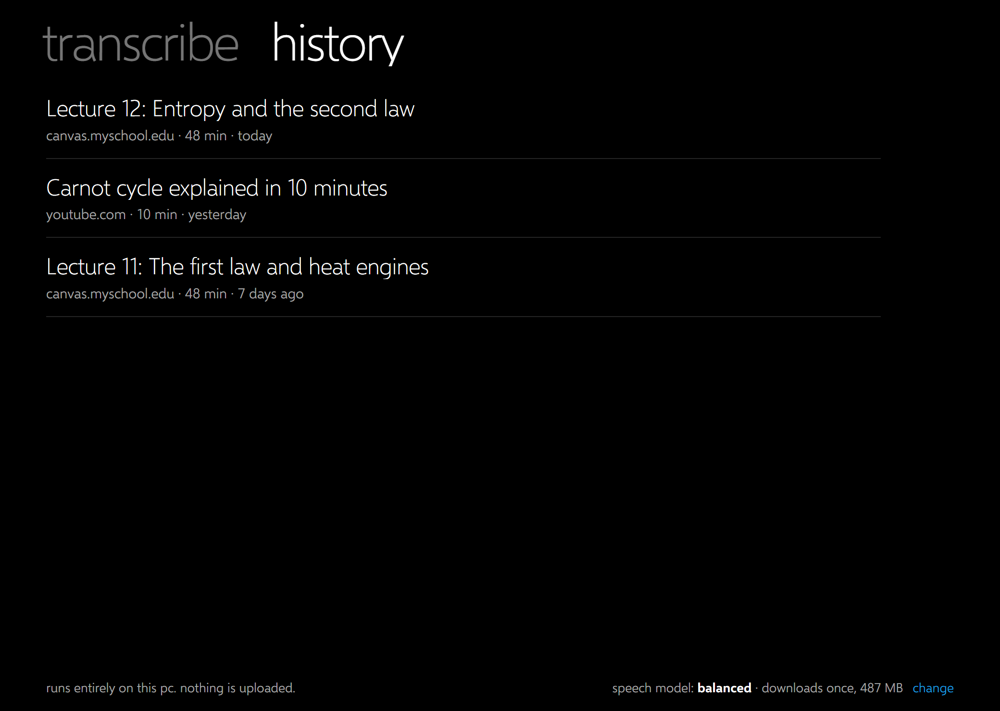
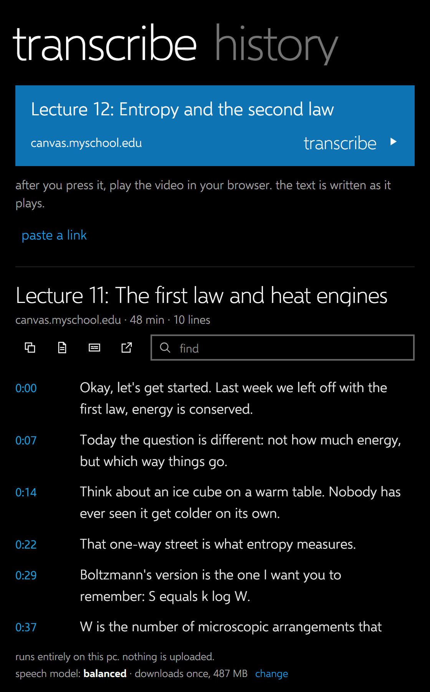
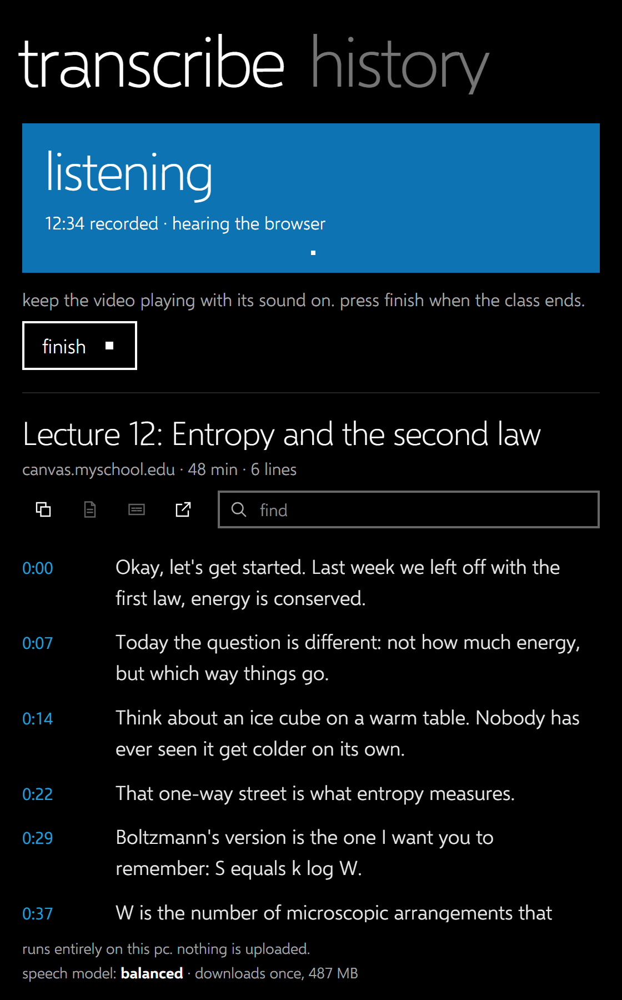
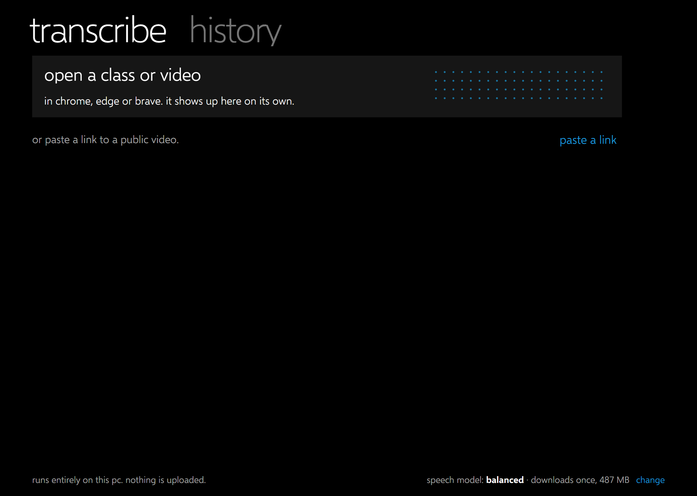
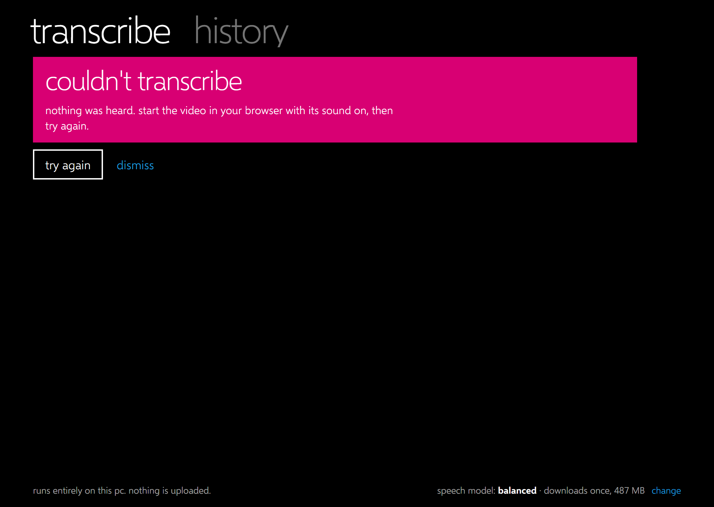

# tabscribe

**Turn the class or video in your browser tab into a full transcript, entirely on your own PC.**

Open a lecture in Chrome, Edge or Brave. tabscribe already knows which tab it is. Press one tile and you get every word, with timestamps, ready to search, copy, or save as subtitles. Nothing is uploaded, and there's no account and no usage limit.

<p align="center">
  
</p>

<p align="center">
  <a href="https://github.com/Gene0Grey/tabscribe/releases/latest"><b>⬇ Download for Windows</b></a>
  &nbsp;·&nbsp; one .exe, nothing to install
</p>

---

## How it works

### 1. Open your class, then press the tile

tabscribe reads the tab you're on: no extension, no copying links. The blue tile shows the lecture's title. Press it.

### 2. It listens while the video plays

Class portals sit behind your school login, so tabscribe doesn't try to download from them. It **listens to the sound your browser plays** and writes the transcript as it goes, about every 25 seconds. Press play, carry on with other work, and press **finish** when the class ends.

<p align="center">
  
</p>

If nothing is playing, it tells you so instead of pretending to work:

<p align="center">
  
</p>

YouTube, Vimeo and other public sites are faster: their audio is downloaded directly and transcribed in a fraction of the video's length, so you don't need to play them.

### 3. Read, search, keep

Every line has a timestamp (on YouTube, click one to jump straight to that moment). Search the whole lecture, copy it, or save it as text or subtitles (.srt). When you come back to a class you've already done, tabscribe says so, so you never sit through it twice by accident.

<p align="center">
  
</p>

Every transcript stays in **history**, on your PC:

<p align="center">
  
</p>

## Fits beside your browser

Snap it next to the class you're watching. The layout narrows to one column and keeps the transcript in view.

<table>
  <tr>
    <td align="center"></td>
    <td align="center"></td>
  </tr>
  <tr>
    <td align="center">ready</td>
    <td align="center">listening</td>
  </tr>
</table>

## Clear when something's wrong

<table>
  <tr>
    <td align="center"></td>
    <td align="center"></td>
  </tr>
  <tr>
    <td align="center">no browser tab yet</td>
    <td align="center">nothing was heard</td>
  </tr>
</table>

<sub>Screenshots are the real interface with sample lecture content.</sub>

## Private by design

- Speech recognition is [whisper.cpp](https://github.com/ggml-org/whisper.cpp) running on your own processor.
- Audio and text never leave your computer. There's no account, no API key and no cloud.
- Transcripts are saved as files in your local app data folder.

## Requirements

| | |
|---|---|
| System | Windows 10 (version 2004) or Windows 11, 64-bit |
| Browser | Chrome, Edge or Brave |
| Processor | any CPU with AVX2 (most PCs from about 2015 on) |
| First run | downloads the speech model once: 147 MB (fast), 487 MB (balanced, the default) or 574 MB (accurate). Change it in the footer. |

Windows may say "Windows protected your PC" because the exe isn't signed yet. Choose **More info → Run anyway**.

## Good to know

- **Live listening hears the whole browser.** Mute other tabs that play sound.
- **Live listening runs at playback speed.** Play the class at 1.5× or 2× to finish sooner.
- **Keep the video's sound on.** The volume can be low, but a muted tab produces no audio to hear.

## Build from source

Needs Rust (MSVC toolchain), Visual Studio C++ build tools, CMake, and libclang.

```bash
pip install libclang
```

```powershell
$env:LIBCLANG_PATH = "<python>\Lib\site-packages\clang\native"
cargo build --release
```

The app is `target\release\tabscribe.exe`. Run the tests:

```bash
cargo test --release
```

`cargo test --release preview` renders every screen to `target/preview/*.html`, which is where the screenshots above come from.

Built with [Dioxus](https://dioxuslabs.com), [whisper-rs](https://github.com/tazz4843/whisper-rs), [wasapi](https://github.com/HEnquist/wasapi-rs), [symphonia](https://github.com/pdeljanov/Symphonia) and [yt-dlp](https://github.com/yt-dlp/yt-dlp).

## License

MIT. See [LICENSE](LICENSE). The speech models are downloaded from the whisper.cpp project, and yt-dlp is downloaded from its official releases; both keep their own licenses. The embedded Selawik font is © Microsoft, under the SIL Open Font License ([assets/Selawik-OFL.txt](assets/Selawik-OFL.txt)).
